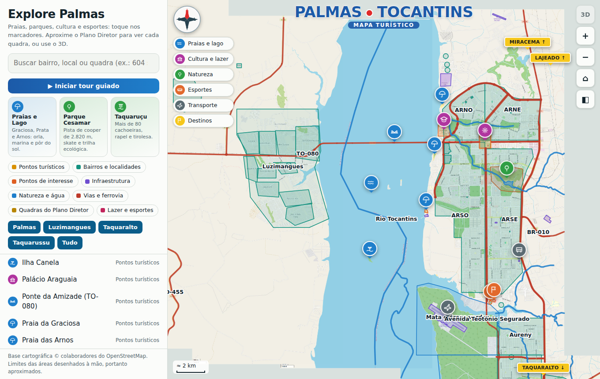
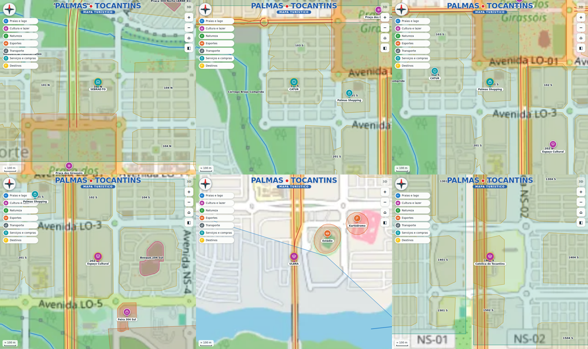
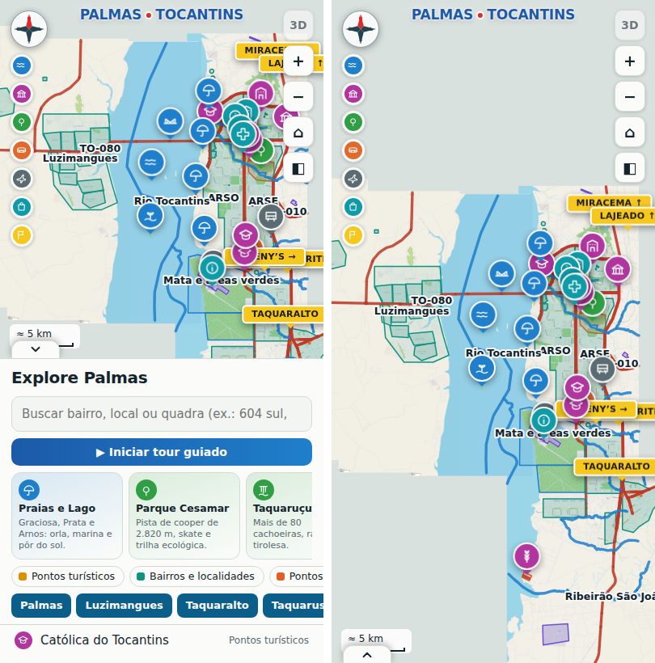

# Palmas · Mapa Turístico (2D + 3D)

Mapa interativo e turístico de **Palmas (Tocantins)**, com as quadras do Plano Diretor, bairros, rodovias,
praias, parques e pontos de interesse, em **visão 2D** e **visão 3D** (com serra, lago animado, barcos,
parapentes e aviões). Funciona no computador e no celular, em um único arquivo HTML.



## O que o mapa faz

* **Marcadores turísticos** com ícones desenhados, agrupados por tema (praias e lago, cultura, natureza,
  esportes, transporte, serviços, placas de destino), com filtros.
* **Áreas clicáveis**: 154 quadras do Plano Diretor (com código novo e antigo, ex.: `604 S` = `ARSE 61`),
  bairros e localidades, vias, rios, lazer e infraestrutura. Cada uma abre uma ficha com descrição.
* **Busca** por bairro, local ou quadra (ex.: `604 sul`, `ARSE 61`).
* **Tour guiado** com 27 paradas e transição “zoom out → deslocar → zoom in”.
* **Modo 3D** (Three.js): câmera livre, atalhos de ângulo (Turística, Topo, Inclinada, Perspectiva, Rasante),
  Serra do Lajeado em relevo, água em movimento, barcos, parapentes, aviões, palmeiras e monumentos.
* **Menu retrátil** (computador e celular) e layout inspirado no mapa turístico de Palmas.

| Pontos turísticos | Celular com menu retrátil |
|---|---|
|  |  |

## Como rodar

Requisitos: Python 3.10+ (só para **gerar** o arquivo; o mapa em si é HTML/JS puro).

```bash
python -m venv .venv
source .venv/bin/activate            # Windows: .venv\Scripts\activate
pip install -r requirements.txt
python src/build.py                  # gera dist/index.html (~2 MB, autocontido)
python -m http.server -d dist 8000   # abra http://localhost:8000
```

Testes (opcional): `pip install -r requirements-dev.txt && pytest`

> O modo 3D baixa o Three.js (r128) do cdnjs sob demanda, e as fontes vêm do Google Fonts. Sem internet,
> o 2D funciona normalmente e o 3D mostra um aviso.

## Publicar no GitHub Pages

O workflow `.github/workflows/pages.yml` gera `dist/index.html`, roda os testes e publica. Basta:
1. Criar o repositório e enviar o código para a branch `main`.
2. Em **Settings → Pages → Build and deployment → Source**, escolher **GitHub Actions**.
3. O endereço será `https://<usuario>.github.io/<repositorio>/`.

## Primeiro envio ao GitHub

```bash
cd palmas-mapa-turistico
git init -b main
git add .
git commit -m "Primeira versão do mapa turístico de Palmas"
git remote add origin https://github.com/<usuario>/<repositorio>.git
git push -u origin main
```
Antes de publicar, preencha o titular em `LICENSE` e leia `docs/FONTES_E_LICENCAS.md` (pendências de licenciamento).

## Estrutura do repositório

```
├─ src/                 código-fonte do mapa
│  ├─ template.html     interface, 2D e 3D (HTML + CSS + JS) — recebe os dados na geração
│  ├─ build.py          gerador: junta imagens + dados + template → dist/index.html
│  ├─ calib.py          conversão lon/lat → coordenadas do mosaico (calibração)
│  └─ paths.py          caminhos do projeto
├─ data/
│  ├─ base/             7 imagens-base (OpenStreetMap) e o layout original do mosaico (SVG)
│  ├─ raw/osm/          3 exportações GeoJSON do OpenStreetMap (Overpass Turbo)
│  ├─ processed/        dados derivados (regiões, quadras, calibração) — gerados por pipeline/
│  └─ external/         arquivos de terceiros NÃO versionados (ver README da pasta)
├─ pipeline/            scripts numerados que transformam os dados brutos em dados processados
├─ docs/                documentação (arquitetura, dados, fontes, como editar, limitações)
├─ tests/               testes automáticos (dados, calibração, navegador)
└─ .github/workflows/   publicação automática no GitHub Pages
```

## Documentação

| Documento | Conteúdo |
|---|---|
| [docs/ARQUITETURA.md](docs/ARQUITETURA.md) | Como o mapa funciona por dentro (2D, 3D, painel, tour) |
| [docs/MODELO_DE_DADOS.md](docs/MODELO_DE_DADOS.md) | Formato das regiões, marcadores e sistema de coordenadas |
| [docs/PIPELINE_DE_DADOS.md](docs/PIPELINE_DE_DADOS.md) | Como os dados foram produzidos e como refazê-los |
| [docs/FONTES_E_LICENCAS.md](docs/FONTES_E_LICENCAS.md) | De onde vem cada dado, licenças e créditos |
| [docs/COMO_EDITAR.md](docs/COMO_EDITAR.md) | Adicionar pontos turísticos, ícones, textos e atualizar dados |
| [docs/LIMITACOES.md](docs/LIMITACOES.md) | O que é aproximado ou ainda não foi validado |
| [CONTRIBUTING.md](CONTRIBUTING.md) | Como contribuir e reportar erros de dados |
| [CHANGELOG.md](CHANGELOG.md) | Histórico de versões |

## Créditos e licenças

* **Código**: MIT (`LICENSE`).
* **Dados**: © colaboradores do OpenStreetMap, ODbL 1.0 (`data/LICENSE-DATA.md`). Mantenha a atribuição.
* **Referências** do mapa turístico de Palmas, capturas do Google Maps e reportagens são citadas como fonte
  nas fichas; fotos e logotipos de terceiros **não** estão no repositório (`docs/FONTES_E_LICENCAS.md`).
* Three.js (MIT) e a fonte Bricolage Grotesque (OFL) são carregados de CDNs públicas.
